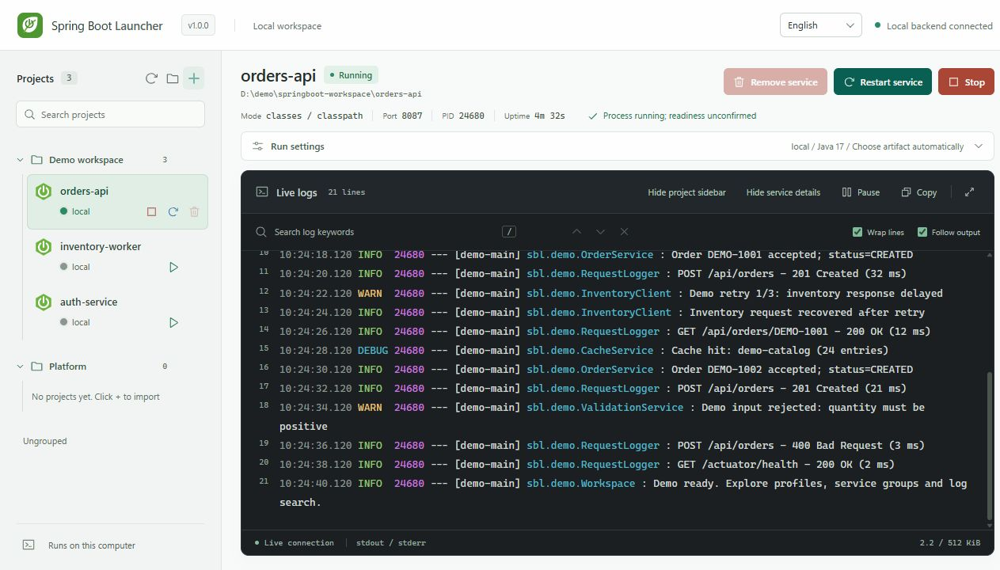
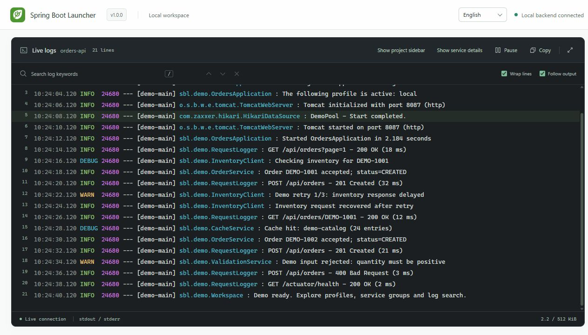

# Spring Boot Launcher

**English** · [简体中文](README.zh-CN.md)

[Project website](https://simplifyOurLife.github.io/springboot-launcher/) · [Getting started](https://simplifyOurLife.github.io/springboot-launcher/#get-started)

Manage local Spring Boot services from Codex, Claude Code, or a shared web dashboard. Start and stop services, organize projects, and follow their logs without opening an IDE.

**Version 1.0.0.** Windows installation, independent dashboard access, and stable-release updates are now implemented. See the [release notes](docs/releases/1.0.0.md) and [acceptance checklist](docs/verification/alpha-acceptance.md), currently in Chinese. Source: [simplifyOurLife/springboot-launcher](https://github.com/simplifyOurLife/springboot-launcher). No npm package has been published.

## What is this project?

This is a **local service management tool with an MCP server interface, a CLI, and a web dashboard**. A shared Node.js backend owns the managed processes and log collection. Codex and Claude Code connect through stdio MCP proxies to that same backend. It is not an Agent Skill; a Skill could provide instructions for using these tools, but is not required.

The backend starts on demand. You do not need to start a separate Node server in a terminal before using the dashboard or MCP tools. Closing a chat does not stop managed services.



Screenshots show the 1.0.0 interface with isolated sample projects and simulated output, not business data or proof of real Spring Boot acceptance. Both screenshots use English. The dashboard supports English and Simplified Chinese, with a language selector in the top bar. It follows the browser language on first use and remembers an explicit selection for the current dashboard origin. A new backend port uses a separate browser storage scope.



## Requirements and installation

For guided Windows installation, [download the online installer](https://simplifyOurLife.github.io/springboot-launcher/install.cmd), then open it. Select the installation folder and choose desktop/Start menu shortcuts and optional Codex/Claude Code integration. Paths are configured automatically. The guide needs a stable GitHub Release with the Windows ZIP and checksums; until the first release is published, use source installation below. If no compatible Node.js is found, it downloads a verified portable runtime from nodejs.org.

After installation, double-click **Spring Boot Launcher** on the desktop or in the Start menu to open the authenticated local dashboard. For a source checkout, double-click **Open Dashboard.cmd** in the repository root. Neither action requires an AI chat. The version button in the top bar can create a desktop shortcut for the current checkout.

The version button also checks for stable releases and opens the install/upgrade guide. Managed installs keep a stable MCP path while switching version directories. Running services block an upgrade unless you explicitly select stopping them in the guide. Source checkouts are preserved. See [installation and updates](docs/usage/installation.md) for details.

- Windows 11 and PowerShell 7.
- Node.js 22.22.2 or a newer compatible version.
- A trusted JDK compatible with your target project.
- A Maven Wrapper in the project, or Maven discoverable through `MAVEN_HOME`, `M2_HOME`, or `PATH`, when artifact preparation is needed.

Download or clone the source to a local directory, such as `D:\tools\springboot-launcher`, then run these commands there:

```powershell
npm ci --ignore-scripts --no-audit --no-fund
node .\bin\springboot-launcher.mjs --help
node .\bin\springboot-launcher.mjs dashboard
```

The project configuration and lockfile use the official npm registry. Dependencies are pinned; the package remains `private:true` to prevent accidental npm publication.

Click **+** or **Import project**, then choose a trusted project directory in the Windows folder picker. Selecting a repository root discovers its Maven Spring Boot application modules. You can create logical folders before importing or drag projects between groups later.

Select a service to review its detected profiles and compatible JDK candidates in **Run settings**. Leave the port blank to use application configuration. Click **Start service**: missing or stale artifacts trigger Maven preparation automatically, with its output shown in the same log panel. There is no separate build button.

To remove an individual project, use the trash button in its sidebar row or the **Remove service** button in the service header. Stop it first; running or orphaned services cannot be removed. Both entries ask for confirmation. This removes launcher records only, keeping the project and log files on disk. It can be imported again later.

The project sidebar starts at 320px. Drag its right edge to resize it, use arrow keys when the separator is focused, or double-click to reset. Width is remembered for the current dashboard origin. Service names occupy the first row; actions follow service status. Remove controls appear on selection, hover, or keyboard focus.

## Connect an MCP client

Replace the example path with the absolute location of your checkout. `node` must be available in the client's environment.

Codex:

```powershell
codex mcp add springboot-launcher -- node "D:\tools\springboot-launcher\bin\springboot-launcher.mjs" mcp
```

Claude Code:

```powershell
claude mcp add --transport stdio springboot-launcher -- node "D:\tools\springboot-launcher\bin\springboot-launcher.mjs" mcp
```

Reopen the client and check its MCP connection. These commands are the manual alternative; the installation guide configures only the clients you select. Both clients share services when using the same Windows user and backend directory. If you set `SPRINGBOOT_LAUNCHER_HOME`, use the same absolute directory in both clients.

Available tools:

| Tool | Purpose |
| --- | --- |
| `spring_boot_discover` | Find application modules |
| `spring_boot_inspect` | Inspect a project and its runtime options |
| `spring_boot_start` | Start a service, preparing artifacts if needed |
| `spring_boot_status` | Query managed service state |
| `spring_boot_logs` | Read a bounded log excerpt |
| `spring_boot_stop` | Stop a managed service |
| `spring_boot_restart` | Restart with the previous run configuration |
| `spring_boot_dashboard` | Generate a short-lived dashboard link |

Example request:

> Inspect D:\demo\orders-service, start it with the local profile and port 8087, prepare Maven artifacts if needed, and open its live log dashboard.

Detailed setup and troubleshooting are currently in Chinese: [Codex](docs/usage/codex.md), [Claude Code](docs/usage/claude-code.md), [troubleshooting](docs/usage/troubleshooting.md).

## Services and logs

- Profiles come from local `application*.properties/yml/yaml` files; the active/default profile is detected where possible. Runtime startup logs can correct the displayed profile. External configuration and unresolved placeholders remain subject to Spring's own resolution.
- JDK discovery reads environment variables, `PATH`, common installation directories, sibling installations, and existing IDEA `.jdks` directories. Candidates show compatibility and source; a custom directory is also supported.
- Only modules with a detected Boot entry point are imported. Inheriting Spring Boot alone does not make a shared library an application. Old import records are checked again, while unreadable or active projects are preserved.
- Existing runnable artifacts are preferred. When necessary, normal startup prepares compilation and runtime dependencies. Multi-module preparation uses the reactor and declared dependencies; this is not a full Maven effective-POM implementation.
- Preparation starts offline. An explicit offline-cache-miss failure can trigger one online retry unless `mvnOffline:true` was explicitly requested. Use `mvnOffline:false` to allow online preparation directly, or `noBuild:true` to require existing artifacts.
- A pre-readiness missing-class exit may trigger one dependency repair if preparation has not already run. Business connection/configuration errors do not trigger unlimited rebuilds. A Maven failure only falls back to direct launch when artifacts recheck successfully and no compilation failure was detected.
- Stop gives immediate visual feedback and keeps collecting logs until output pipes close. On Windows, Java termination first tries a non-forced stop, then forces termination after up to eight seconds. JVM shutdown hooks and complete application shutdown output are not guaranteed.
- Search retains continuous log context, highlights matching lines and keywords, and supports previous/next navigation. Searching pauses automatic scrolling while the backend continues collecting output.
- ANSI standard, 256-color, and RGB output is supported, including common text styles. Log files, copied output, and search remain plain text. Language switching does not translate application logs, project names, paths, or configuration values.
- Project navigation and service details collapse independently. The focused log view keeps the current service name visible. Layout state and unsaved run settings last for the current page only.
- The display window is limited to 1,200 lines. Search covers the current buffer, not all files on disk. Each project has a 512 KiB memory log buffer and up to four rotating 10 MiB log files.
- Process state and readiness are separate. A listening port alone does not prove readiness; an optional local HTTP Actuator health URL can confirm `UP` or `DOWN`.

## Local access and upgrades

The backend listens only on `127.0.0.1`, with an automatically assigned port. Its default state directory is `%LOCALAPPDATA%\springboot-launcher`. Dashboard links contain single-use tickets valid for 60 seconds; generate a new link if one expires. Do not share tickets or local state files.

```powershell
# Query state; start the backend on demand if necessary
node .\bin\springboot-launcher.mjs status
# Exit the backend only when no services are active
node .\bin\springboot-launcher.mjs daemon stop
# Explicitly stop all managed services and exit the backend
node .\bin\springboot-launcher.mjs daemon stop --stop-services
```

Before upgrading, stop managed services and exit the backend, update source and dependencies, then run `dashboard` again. The backend does not hot-reload source changes; refreshing an old port does not load a new backend version.

The launcher runs trusted applications with your current user permissions; it is not an application sandbox. It only stops its own managed processes. On reopening, records for exited processes or a confirmed system restart are cleared automatically, leaving services stopped and preserving projects and logs. Services are not started automatically. Live or unverifiable orphaned processes still require manual review and are not adopted or killed by historical PID.

Gradle, non-Windows platforms, remote management, and a dedicated embedded client sidebar are outside the current acceptance scope. Real Java/Maven execution, complex projects, cross-client operation, and cloud CI still require complete acceptance records.

## Development and contribution

```powershell
npm test
npm pack --dry-run --json --ignore-scripts
```

Automated tests use isolated fixtures and simulated processes; they do not build real Java projects. Windows CI runs on GitHub Actions; see [workflow results](https://github.com/simplifyOurLife/springboot-launcher/actions/workflows/test.yml). The public website lives in `site/` and deploys directly to GitHub Pages without a frontend build.

[Architecture](documentation/architecture.md) · [Contributing](CONTRIBUTING.md) · [Security](SECURITY.md) · [Code of conduct](CODE_OF_CONDUCT.md) · [Changelog](CHANGELOG.md) · [Release checklist](docs/release-readiness.md). Supporting documents are currently primarily in Chinese.

Licensed under [Apache License 2.0](LICENSE). Adapted code and dependency attribution are documented in [Third-party notices](THIRD_PARTY_NOTICES.md). This is an independent project, not an official Codex, Claude Code, or Spring Boot product.
