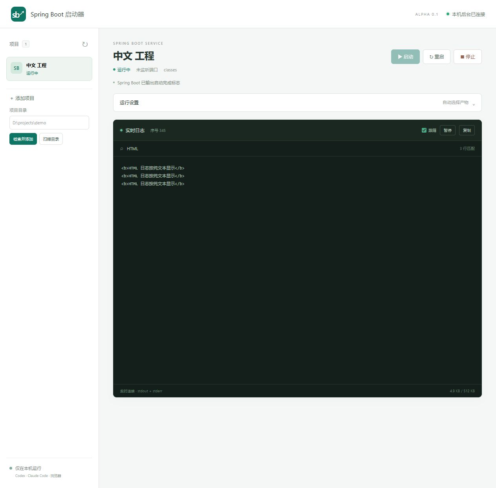

# Spring Boot 启动器

在 Codex 或 Claude Code 中操作本地 Spring Boot 服务，在同一网页面板实时查看日志，无需为启停服务打开 IDEA。

当前版本为 **0.1.0-alpha.1，本地 MVP，待真实工程验收**。共享后台、八个 MCP 工具和中文面板已经实现，自动测试及模拟浏览器验证见[验证记录](docs/verification/mvp.md)。尚未公开发布 GitHub 仓库或 npm 包。



截图使用隔离模拟项目，日志不是实际业务数据，不能代表真实 Spring Boot 验收。

## 使用

首版环境：Windows 11、PowerShell 7、Node.js 22.22.2 或更新的兼容版本，以及目标工程要求的可信 JDK。只支持 Maven Spring Boot 的已有可执行 jar 或 classes。Gradle、其他操作系统、远程访问和固定客户端侧栏尚未验收。

取得本仓库源码，放在任意本地目录，例如 `D:\tools\springboot-launcher`。在该目录执行：

```powershell
npm ci --ignore-scripts --no-audit --no-fund
node .\bin\springboot-launcher.mjs --help
node .\bin\springboot-launcher.mjs dashboard
```

最后一条命令打开本机面板。添加**可信工程的应用模块目录**，点击检查，填写 Profile、JDK、端口等配置，再启动。缺少或过期产物时提示 `BUILD_REQUIRED`，请自行构建后重试；启动器不会执行 Maven 或前端 build。

接入说明：[Codex](docs/usage/codex.md) · [Claude Code](docs/usage/claude-code.md) · [故障排查](docs/usage/troubleshooting.md)。两个客户端使用同一 Windows 用户和同一后台目录即可共享服务，无需分别部署后台。

如需先用不含业务配置的工程验收，可使用[公开示例](examples/demo-service/README.md)，按其中说明自行构建后再启动。

## 服务与日志

- 支持检查、发现、启动、查询状态、读取日志、停止、重启、打开面板。
- 聊天结束不会停止服务。停止只作用于当前后台拥有的子进程，不按端口终止其他程序。
- 面板可暂停显示、搜索当前缓冲、复制和跟随滚动；断线后补取有限日志，缺口明确提示。
- “进程运行中”与“应用就绪”分别显示。仅端口可连接时不宣布就绪，可选本机 Actuator 健康检查持续确认 UP／DOWN。
- 每个项目内存日志最多 512 KiB；项目 `logs` 目录保留最多四份、每份 10 MiB 的轮转日志。主动通过 MCP 查询的片段会进入当前 AI 会话。

后台仅监听 `127.0.0.1`，端口自动分配，默认状态目录为 `%LOCALAPPDATA%\springboot-launcher`。面板链接含 60 秒单次票据，过期时重新打开；不要分享链接或本机状态文件。

```powershell
# 查看状态；无后台时会按需创建后台
node .\bin\springboot-launcher.mjs status
# 没有运行服务时退出后台
node .\bin\springboot-launcher.mjs daemon stop
# 明确停止全部托管服务并退出后台
node .\bin\springboot-launcher.mjs daemon stop --stop-services
```

Windows 停止操作不保证执行 JVM 优雅关闭钩子。后台异常后的遗留进程需要人工处理，不会自动接管。启动器以当前用户权限运行可信应用，不提供应用沙箱。

端口留空时采用应用配置，面板不猜测实际端口；显式填写时执行覆盖和冲突预检查。极少数后台交接中断需按故障排查人工处理，不能通过删锁强行启动第二后台。

## 开发与开源

```powershell
npm test
npm pack --dry-run --json --ignore-scripts
```

测试使用隔离夹具和模拟子进程，不执行 Java 或前端 build。已准备 Windows CI 配置，云端执行仍待公开仓库建立后验证。

[架构与权限](documentation/architecture.md) · [贡献指南](CONTRIBUTING.md) · [安全策略](SECURITY.md) · [行为准则](CODE_OF_CONDUCT.md) · [发布清单](docs/release-readiness.md) · [变更记录](CHANGELOG.md)。

采用 [Apache License 2.0](LICENSE)，外部来源和依赖见[第三方说明](THIRD_PARTY_NOTICES.md)。Codex、Claude Code、Spring Boot 等名称仅用于说明集成对象，本项目不代表这些产品的官方项目或背书。
