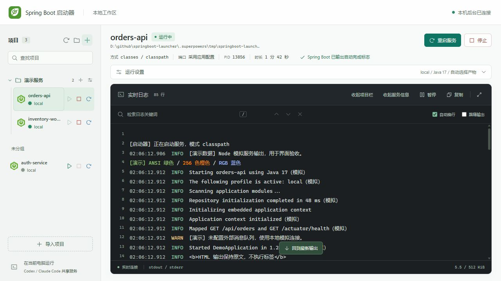
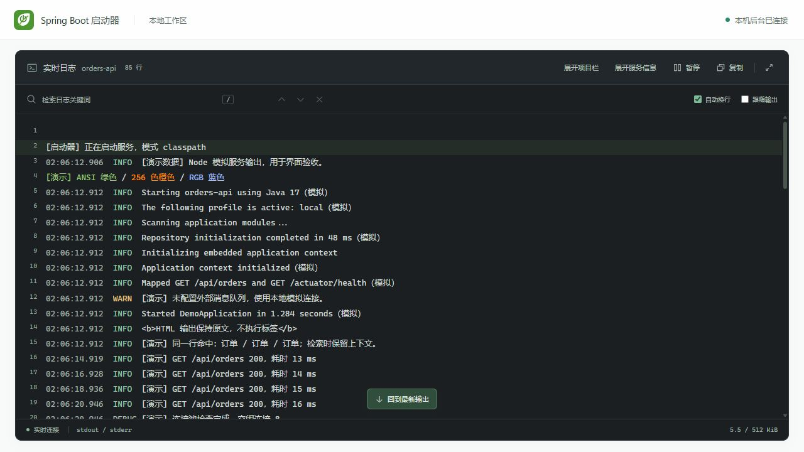

# Spring Boot 启动器

[English](README.md) · **简体中文**

在 Codex 或 Claude Code 中操作本地 Spring Boot 服务，在同一网页面板实时查看日志，无需为启停服务打开 IDEA。

当前版本为 **0.1.0，首个基础版本**，面向 Windows 本机 Maven Spring Boot 开发。共享后台、八个 MCP 工具和中英文面板已经实现；完整真实工程与双客户端交叉使用仍待验收。查看[基础版本发布说明](docs/releases/0.1.0.md)和[简短验收表](docs/verification/alpha-acceptance.md)。源码仓库：[simplifyOurLife/springboot-launcher](https://github.com/simplifyOurLife/springboot-launcher)。未发布 npm 包。



截图来自当前版本页面，使用隔离模拟项目与 Node 演示日志，不含真实业务数据，也不代表真实 Spring Boot 验收。展示新版品牌图标、服务分组、Profile、启停按钮和 ANSI 彩色日志。

项目栏与服务信息可以分别收起，日志几乎占满整个工作区，顶部仍保留当前服务名称和展开入口。



Profile、JDK 结果见[运行环境验证](docs/verification/panel-runtime-options-2026-10-10.md)，后续修复见[验证补充](docs/verification/alpha-followups.md)。

项目栏默认宽度 320px，可拖动右侧边缘调整，聚焦分隔条后也可用方向键微调，双击恢复默认；宽度按当前来源记忆。名称独占首行，操作按服务状态显示，移除按钮在选中、悬停或键盘聚焦时出现。

## 项目定位与语言

本项目是带 MCP 接口、CLI 和网页面板的本机 Spring Boot 服务管理工具。共享 Node.js 后台托管服务进程并收集日志；Codex、Claude Code 通过 stdio MCP 代理连接同一后台。本项目不是 Skill，也不要求先安装 Skill。

面板右上角可切换简体中文和英文，首次跟随浏览器首选语言，在当前页面来源记住手动选择；后台端口改变时使用独立浏览器存储。原始应用日志、项目名、路径和配置值不翻译，CLI／MCP 文案与未知后台诊断保留现有语言。可通过左侧服务行垃圾桶按钮，或顶部带边框的“移除服务”按钮，确认后移除单个已停止的服务；只清理启动器记录，不删除磁盘工程或日志文件。运行中或待人工确认的服务不可移除。

## 使用

首版环境：Windows 11、PowerShell 7、Node.js 22.22.2 或更新的兼容版本，以及目标工程要求的可信 JDK。支持 Maven Spring Boot 的 jar／classpath 启动；需要自动准备产物时，工程应提供 Maven Wrapper，或本机 Maven 可由 MAVEN_HOME、M2_HOME、PATH 找到。Gradle、其他操作系统、远程访问和固定客户端侧栏尚未验收。

取得本仓库源码，放在任意本地目录，例如 `D:\tools\springboot-launcher`。在该目录执行：

```powershell
npm ci --ignore-scripts --no-audit --no-fund
node .\bin\springboot-launcher.mjs --help
node .\bin\springboot-launcher.mjs dashboard
```

最后一条命令打开本机面板。点击左侧 **+**，在 Windows 系统窗口中选择可信 Spring Boot 项目目录；选择项目根目录时会扫描并导入其中的 Maven Boot 应用模块。也可先创建文件夹，再通过文件夹旁的 **+** 导入。选中项目后自动识别 Profile，并扫描、推荐兼容 JDK；展开“运行设置”可从下拉框切换，端口留空时使用应用配置。直接点击“启动服务”：缺少或过期产物时自动执行 Maven 编译及运行依赖准备，进度和输出进入日志面板，期间可以停止；无需单独点击构建按钮。

接入说明：[Codex](docs/usage/codex.md) · [Claude Code](docs/usage/claude-code.md) · [故障排查](docs/usage/troubleshooting.md)。两个客户端使用同一 Windows 用户和同一后台目录即可共享服务，无需分别部署后台。

如需先用不含业务配置的工程验收，可使用[公开示例](examples/demo-service/README.md)，按其中说明自行构建后再启动。

## 服务与日志

- 支持检查、发现、启动、查询状态、读取日志、停止、重启、打开面板。
- 导入从点击起显示旋转 loading，区分打开系统窗口、识别模块、保存结果和读取运行环境，期间防止重复提交。只导入有 Boot 启动入口的模块，继承 Boot 的基础库不作为服务；后台启动时复核旧导入记录，重新导入根目录时也会清理该范围内经确认的非应用记录。无法读取、仍在运行或待人工确认的项目保留，不移动或删除磁盘工程。
- 已有薄 jar 的 `Class-Path` 可以包含资源目录；classpath 支持 `target/config`、assembly 的 `target/*/lib` 和嵌套 reactor 的传递声明依赖。自动模式在 jar 过期时尝试新鲜 classes，增量编译按对应源码校验。
- 普通启动在需要时自动执行 `compile dependency:copy-dependencies`，多模块从根目录使用 `-pl/-am`，排除由工作区 classes 提供的内部依赖；显式 jar 模式使用 package。准备成功后重新检查产物再启动 Java，失败保留退出码和日志。默认沿用 dsh 离线模式，明确检测到离线缓存缺失时自动联网重试一次；MCP 可设置 `mvnOffline:false` 或 `noBuild:true`。对照范围见[兼容性记录](docs/verification/dsh-compatibility-2026-10-10.md)。
- 应用尚未就绪、且本次还未执行准备时，缺类退出会触发一次运行依赖准备及重试；业务连接或配置错误不触发该修复。Maven 失败后，只有重新检查确认 classes 与依赖可用且未识别到编译错误，才尝试直接启动。面板无需配置 Maven 网络参数；MCP 显式设置 `mvnOffline:true` 时不会自动切换联网。
- 聊天结束不会停止服务。停止只作用于当前后台拥有的子进程，不按端口终止其他程序。
- 点击停止后立即提示“正在停止”，对应服务行按钮显示加载状态。Windows Java 停止先尝试非强制终止，等待最多 8 秒后才强制结束；日志采集持续到子进程输出管道关闭。是否输出完整关闭日志取决于 JVM、应用和停止方式，不能保证执行关闭钩子。
- 左侧支持创建、改名和移除文件夹，以及拖拽项目到文件夹或未分组；键盘可在项目上按 Ctrl+Shift+M，再聚焦目标文件夹按 Enter。文件夹是逻辑分组，不移动磁盘工程；分组与导入记录保存在本机后台，刷新后仍保留。运行设置草稿仅保存在当前页面，刷新后不保留。
- 日志检索保留连续上下文，淡亮命中行并高亮关键词，支持上一处／下一处及 Enter／Shift+Enter 导航。聚焦检索框时固定当前显示并停止自动滚动，后台继续接收；Esc 或关闭按钮退出检索并恢复此前的跟随设置。
- 服务行使用 Spring Boot 风格图标和 9px 状态圆点，显示运行记录或已识别的 Profile；识别不到时显示“应用配置”。启动、停止、重启按钮分别为绿、红、蓝色，按钮仅操作对应服务；重启复用上次运行配置。
- Profile 下拉列表来自本地 `application*.properties/yml/yaml`、多文档条件和 Profile 分组；自动带入默认值并提示来源。自动识别不额外覆盖应用配置，主动选择其他项才通过启动参数覆盖；识别到 Spring 启动日志时校正实际 Profile。外部配置或未解析占位符会提示扫描边界。
- JDK 从环境变量、PATH、常见安装目录、已有安装的同级目录与 IDEA 的 `.jdks` 发现，按项目 Java 最低版本和 IDE／`.java-version` 提示推荐。候选显示版本、来源与兼容性，也可填写自定义目录；扫描只读元数据，启动时再次验证 Java 版本。
- 右侧顶部采用紧凑服务摘要，运行设置默认收起，jar、classpath、JVM 和健康检查参数放入“更多启动参数”，为日志保留更多空间。
- 大屏工作台使用可用宽度；日志工具栏可以分别收起项目栏和服务信息，也可一键进入专注视图。收起后仍显示当前服务名称；折叠只保留在当前页面，不重建日志连接。
- 日志支持 ANSI 标准色、256 色、RGB、字重、斜体、下划线；应用需要实际输出 ANSI 序列。日志文件、检索和复制仍是纯文本。
- 日志支持行号、级别着色、自动换行、专注视图、暂停和复制当前连续显示窗口。每次最多显示 1200 行，检索仍覆盖当前固定缓冲，可导航到较早命中；断线后补取有限日志，缺口明确提示。
- “进程运行中”与“应用就绪”分别显示。仅端口可连接时不宣布就绪，可选本机 Actuator 健康检查持续确认 UP／DOWN。
- 每个项目内存日志最多 512 KiB；项目 `logs` 目录保留最多四份、每份 10 MiB 的轮转日志。主动通过 MCP 查询的片段会进入当前 AI 会话。

后台仅监听 `127.0.0.1`，端口自动分配，默认状态目录为 `%LOCALAPPDATA%\springboot-launcher`。面板链接含 60 秒单次票据，过期时重新打开；不要分享链接或本机状态文件。

源码更新后，先停止托管服务，再执行下方的 `daemon stop`，随后重新执行 `dashboard`。后台不会自动热更新；页面资源与后台按同一次启动加载，刷新旧端口不能替代后台更新。

```powershell
# 查看状态；无后台时会按需创建后台
node .\bin\springboot-launcher.mjs status
# 没有运行服务时退出后台
node .\bin\springboot-launcher.mjs daemon stop
# 明确停止全部托管服务并退出后台
node .\bin\springboot-launcher.mjs daemon stop --stop-services
```

Windows 停止操作不保证执行 JVM 优雅关闭钩子。后台异常后的遗留进程需要人工处理，不会自动接管。启动器以当前用户权限运行可信应用，不提供应用沙箱。

端口留空时采用应用配置，面板不猜测实际端口；显式填写时执行覆盖和冲突预检查。极少数后台交接中断需按故障排查人工处理，不能通过删锁强行启动第二后台。

## 开发与开源

```powershell
npm test
npm pack --dry-run --json --ignore-scripts
```

测试使用隔离夹具和模拟子进程，不执行真实 Java、Maven 或前端 build；产品由使用者点击启动时可以准备 Maven 产物。已准备 Windows CI 配置，云端执行仍待公开仓库建立后验证。

[架构与权限](documentation/architecture.md) · [贡献指南](CONTRIBUTING.md) · [安全策略](SECURITY.md) · [行为准则](CODE_OF_CONDUCT.md) · [发布清单](docs/release-readiness.md) · [GitHub 发布步骤](docs/maintainers/github-release.md) · [变更记录](CHANGELOG.md)。

采用 [Apache License 2.0](LICENSE)，外部来源和依赖见[第三方说明](THIRD_PARTY_NOTICES.md)。Codex、Claude Code、Spring Boot 等名称仅用于说明集成对象，本项目不代表这些产品的官方项目或背书。
