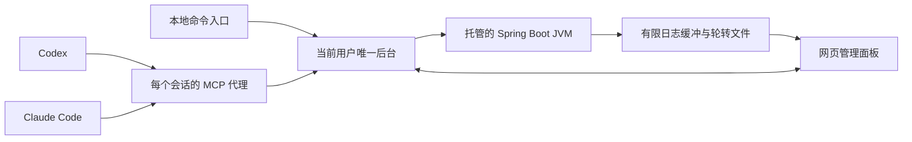

# Spring Boot 启动器首个 MVP 设计

## 设计状态与用户目标

用户已确认采用“共享本地后台＋MCP 接口＋网页管理面板”，并确认本书面设计，计划在首个 MVP 验收后发布到 GitHub。当前仓库没有产品代码，下面的行为均为待实现要求，不代表已经验证；[实施计划](../plans/2026-10-09-shared-springboot-launcher-mvp.md) 等待审阅及执行方式确认。

目标是在不打开 IDEA 的情况下，由 Codex、Claude Code 或网页面板启动、查看和停止可信的 Maven Spring Boot 服务。成功标准是两种客户端操作同一个后台及同一组 JVM，实时日志无需不断通过模型刷新，普通聊天结束不会停止服务。

第一阶段只在 Windows 11、PowerShell 7 和 Node.js 22.22.2 环境验收。Gradle、Linux、macOS、远程管理及固定客户端侧栏入口不进入首个 MVP。界面以中文为主；代码标识遵循英文命名。

## 1. 架构与交付方式

- MCP 代理通过 STDIO 与客户端通信，按需发现或启动当前用户的唯一后台。多个代理必须连接同一个后台，不各自管理 JVM。
- 后台使用 Node.js，控制接口和静态页面只监听 127.0.0.1，使用系统分配的可用端口。端口、实例标识及凭据保存在当前用户的私有状态目录，通过本地代理发现，用户无需管理端口。
- 后台运行独立于 MCP 代理；代理退出和聊天结束只断开连接。后台正常退出时，如存在运行中的服务，应拒绝退出并提示用户先停止服务；只有用户明确选择停止全部托管服务后才可统一关闭。
- 首版交付源码安装方式和 Codex、Claude Code 的接入说明。插件包装、公共 npm 包、开机自启和 Windows 系统服务属于后续分发能力。
- 网页面板可以在 Codex 桌面版的浏览器面板或系统浏览器打开。CC 终端版通过同一个网页地址查看面板，不假设其提供内嵌网页接口。
- 不修改目标业务工程源码，也不依赖 DSH、IDEA 或任一 AI 客户端的私有接口。

### 唯一后台与恢复边界

首次启动使用原子锁和实例健康握手，防止两个客户端同时建立两个后台。发现实例时必须核对随机实例标识、持有的凭据和健康接口；不能把“某个端口有人监听”当作启动器身份。

连接失败、后台启动超时及陈旧锁分别报告，有限等待后退出，不无限重试。回收锁前须确认锁拥有者已退出且实例不可达；锁拥有者尚存但无响应时报告错误，不擅自启动第二个后台。

后台记录托管 JVM 的最少元数据，用于异常退出后的诊断。聊天重连可以继续管理仍然运行的同一个后台；后台进程崩溃后的自动接管和 Windows 重启后的恢复不进入 MVP。发现上次后台异常退出留下的服务记录时标为“需要人工确认”，禁止依据旧 PID 接管、终止或直接重复启动该项目。

## 2. 项目检查与运行范围

### 检查

只读检查项目目录、pom.xml、Spring Boot 入口类、配置文件中的 Profile 和端口、目标 JDK、本机 JDK 候选，以及已有 jar、classes 和依赖目录。参数中的项目目录须为规范化绝对路径；解析真实路径，避免 Windows 大小写和目录联接形成重复项目。

提供手动添加项目和在用户指定根目录中发现项目两种入口。扫描跳过 .git、node_modules、target 等目录，不跟随目录联接或符号链接；限制深度、目录数量和耗时，达到限制时返回截断提示。Maven 多模块只选择应用模块，不对父 POM 发起启动。

无法确定入口类、JDK 或可用运行依赖时返回可解释的错误，不猜测成功。Profile 指运行时 Spring Profile；切换 Maven 构建 Profile 所需产物由用户事先准备，不能把二者混为同一配置。

### 启动

首版默认不自动执行 Maven 构建、编译或依赖下载：

1. 已有可执行 Spring Boot jar 且适合运行时，使用 java -jar。
2. 有新鲜的应用 classes 和完整运行依赖时，使用 java -cp 加入口类；复用已有多模块分析，支持已准备好的兄弟模块 classes。
3. 产物缺失、明显过期或依赖不全时，返回 BUILD_REQUIRED 及需要准备的内容，由用户完成构建后重试。

可显式指定 jar 文件、JDK、入口类及 classpath，以支持源码安装用户的不同 Maven 输出布局；这些路径必须存在。显式模式仍需检查产物可用性和新旧情况，不静默运行已知过期产物。复杂 Maven 插件副作用或自定义打包布局无法可靠推断时应提示使用显式参数。

进程用参数数组直接启动 Java 可执行文件，shell=false、windowsHide=true，不拼接 PowerShell 或 cmd 命令。可配置项目工作目录、Spring Profile、端口和 JVM 选项；禁止通过 JVM 参数改写启动入口、增加参数文件或覆盖启动器已决定的 classpath。环境变量继承当前用户环境；首版不新增面板凭据编辑或持久化功能。

同一个规范化项目只能有一个活动启动请求或托管 JVM；两个客户端及面板的并发启动须收敛到同一个结果。端口已占用时仅报告 PORT_IN_USE，不停止占用进程。

### 停止与重启

停止只针对当前后台保存的托管子进程句柄。已经退出时返回当前终态，禁止根据端口或未经核实的 PID 寻找并终止其他进程。Windows 下不承诺执行 JVM 的优雅关闭钩子；面板及文档须明确这一限制。任意应用额外派生进程的完整树管理暂不属于支持承诺。

重启按“停止成功→用上次已验证的非敏感配置再次检查和启动”执行。停止失败或进程仍活跃时不继续启动第二个 JVM。修改配置或产物后须重新检查，不复用过期的运行决策。

## 3. 进程状态与就绪判断

状态为 stopped、starting、running、stopping、exited、failed 和 orphaned。每个项目保存项目标识、目录、PID（可用时）、启动时间、运行模式、端口、就绪证据、退出码和日志位置。

running 表示 JVM 仍然存活，不等于应用已就绪。就绪证据区分 TCP 可连接、Spring Boot 已输出启动完成标志、以及显式配置的健康检查成功；TCP 可连接不得宣传为完整健康检查。无健康证据时显示“进程运行中，就绪未确认”。启动检查超时不直接判定进程已死，也不自动终止仍存活的 JVM。

所有入口从同一进程注册表查询状态。Java 启动失败、标准错误、进程退出及后台异常都必须形成结构化状态或关键诊断信息，不能只在面板内显示。

## 4. MCP 工具与本地命令

所有 MCP 工具返回结构化结果及简短中文说明。成功结果包含 ok=true 和 data；失败结果包含 ok=false、error.code、error.message 及可选的可公开修复提示。服务启动是提交操作，尽快返回 starting 和项目标识，后续通过 status 查询，不把持续运行的 JVM 当作长时间工具调用。

| 工具 | 参数要点 | 结果与副作用 |
| --- | --- | --- |
| spring_boot_discover | root、受限扫描选项 | 返回发现的项目和扫描截断情况；只读 |
| spring_boot_inspect | dir | 返回检查及推荐运行配置；只读 |
| spring_boot_start | dir、profile、port、jdkHome、mode、jarPath、mainClass、classpath、jvmArgs | 检查并提交启动；参数均明确校验 |
| spring_boot_status | dir 可选 | 查询单个项目或全部已托管项目；只读 |
| spring_boot_logs | dir、lines 默认 100，最多 1000 | 返回有上限的日志片段和截断提示；只读 |
| spring_boot_stop | dir | 停止该后台拥有的 JVM |
| spring_boot_restart | dir | 验证停止成功后重新检查并启动 |
| spring_boot_dashboard | 无必需参数 | 返回带短期单次访问票据的面板地址 |

只读工具标注 readOnlyHint；启动、停止和重启不能标为只读。停止和重启应描述影响，客户端保留自己的工具审批机制。服务端不能把工具注解或 MCP 建议当作授权依据。

本地命令至少提供 mcp、dashboard、status 和后台退出入口。首版推荐两种客户端都配置本地 STDIO 代理；不要求用户手动保持后台终端窗口。直接 HTTP MCP 接入可后续增加，不是当前双客户端验收的前提。

常见错误至少包括 INVALID_ARGUMENT、UNSUPPORTED_PROJECT、JDK_NOT_FOUND、BUILD_REQUIRED、PORT_IN_USE、ALREADY_RUNNING、START_FAILED、STOP_FAILED、BACKEND_UNAVAILABLE 和 ORPHANED_SERVICE。

## 5. 网页面板与实时日志

使用静态 HTML、CSS 和 JavaScript，避免前端构建步骤。布局包含项目列表、运行配置、启动／停止／重启按钮、服务状态和日志查看区域，适配右侧窄面板及普通浏览器窗口。

面板通过已认证的同源请求执行操作，通过 SSE 接收状态和日志事件。日志事件携带项目标识、单调递增序号、时间、来源和文本。浏览器重连时先加载有限快照，再从序号继续；发生缓冲缺口时明确提示，不显示为连续日志。

- stdout 和 stderr 均接入，使用 UTF-8 增量解码处理跨块中文字符。
- 每个服务的内存尾部日志最多 512 KiB；面板也限制显示缓冲，避免长时间运行无限占用内存。
- 本地日志默认位于项目 logs/springboot-launcher.log，10 MiB 轮转、合计最多四份。写入失败时状态和实时流继续工作，并提示持久化失败。
- 提供自动滚动、暂停显示、当前缓冲内搜索和复制。暂停显示不停止后台采集；历史全文检索不进入 MVP。
- 日志按纯文本渲染，不能当 HTML 执行。日志可能包含敏感信息，MVP 不承诺识别并脱敏所有应用输出。
- MCP 日志读取最多返回 256 KiB 文本；面板实时日志不会逐条进入模型。用户主动查询的 MCP 日志片段会进入当前 AI 会话。

## 6. 本地访问与数据边界

后台是当前用户的可信本地工具，不是执行不可信工程的沙箱。不提供公网监听、远程登录、多人角色、云端日志存储或内置 LLM 调用。

- 私有状态目录默认位于 Windows LOCALAPPDATA 下，开发／自动测试可显式切换到隔离临时目录。文件限制为当前用户可读写，不能以仅使用“隐藏目录”代替权限。
- 后台每次启动生成高强度随机控制凭据；代理经私有文件取得。所有控制请求须核对凭据、实例身份和准确的本机 Host。
- 后台控制凭据至少使用 32 字节加密随机数。面板入口使用 60 秒有效的单次票据，通过 URL fragment 传给前端，再交换 HttpOnly、SameSite=Strict 会话 cookie；会话有效期为 8 小时，后台重启后失效。票据在使用后失效，并从地址栏移除。长期控制凭据不能发送给网页，也不能放入仓库、页面包或日志。
- 受保护的浏览器请求须核对同源 Origin／Fetch Metadata；SSE 和状态查询同样需要会话认证。未认证请求应拒绝，不能因来自回环地址而放行。
- 控制请求体设置大小和读取时间上限；禁止任意 shell 命令接口、任意文件读写接口或后台代理公网请求。
- JDK、工程和应用运行于当前用户权限下。真实日志和配置留在用户机器；诊断收集由用户主动选择，不设置遥测上传。

## 7. 旧代码迁移与开源材料

迁移参考来源为 DSH Spring Boot Launcher。原工程声明 Apache-2.0，并在 LICENSE 中包含原版权标记。新工程沿用 Apache-2.0；复制实现时保留原许可证及版权、记录来源文件和来源修订，并在修改文件中注明适配。

仅迁移实际需要的项目分析、JDK 发现、产物决策和日志逻辑；不复制 DSH 宿主登录、全权限策略、侧栏插槽和私有模块加载器。将旧入口中的不同职责拆分为可独立验证的模块，而非直接复制完整宿主入口。

首版发布材料包含 README、LICENSE、第三方来源说明、CONTRIBUTING、SECURITY、Issue／PR 模板、架构与权限／配置文档、验证记录、变更记录，以及 Codex／CC 的接入说明。社区文档不得使用真实业务路径、内部域名、访问凭据或未经检查的日志与截图。

README 必须区分已实现与待实现、自动测试与人工验收，不使用未验证的平台徽章或不存在的发布包安装指令。发布前补齐公开可复现的示例和脱敏截图。当前只在本地建仓库，不创建远端仓库、不上传、不推送或发布 npm 包。

## 8. 验证与 MVP 验收

实现阶段使用 Node.js 内置测试运行器验证关键行为，自动测试仅使用临时项目、假 JVM／子进程和本地 HTTP，不执行 Java 工程或前端 build。测试需要覆盖：

1. 两个 MCP 代理同时连接时只产生一个后台、同一项目只启动一个子进程。
2. Codex 入口启动后，第二客户端及网页查询、日志和停止得到一致状态。
3. 代理退出不停止后台及托管服务，后台退出入口在存在服务时拒绝关闭。
4. 产物缺失／过期时返回 BUILD_REQUIRED，任何路径都不隐式编译或下载依赖。
5. 端口冲突、JDK 缺失、进程快速退出、重复启动和停止失败得到正确错误与状态。
6. 未认证、错误凭据、伪造 Host、跨站请求、过期／重复票据和过大请求体均拒绝。
7. UTF-8 跨块字符、stdout／stderr、日志轮转、写盘失败、SSE 重连和日志缺口处理正确。
8. 日志 HTML 不执行，前端缓冲有上限，源代码和配置不含真实凭据。
9. 后台异常后旧记录被隔离，不依旧 PID 终止或重复启动可能仍存在的服务。

真实环境验收由用户在可信且已完成必要构建的 Maven Spring Boot 工程上进行：Codex 启动→面板看到状态与连续日志→CC 查询并停止→面板显示停止→CC 再次启动→Codex 查询和停止。需要记录客户端版本、JDK／Maven 版本、运行模式及结果，不复制业务日志到公开仓库。

GitHub 发布前必须满足自动测试通过、上述双客户端与网页实际验收、文档安装步骤在干净目录验证、许可证与依赖清单核对、公开文件脱敏检查及使用者权限说明。没有验证的项目保持未完成状态。

## 9. 技术与工程约束

- Node.js ESM；最低版本和首版测试基线均为 22.22.2，较新版本不因满足版本范围就被宣传为已经验收。
- MCP 采用官方 Node.js SDK，使用官方支持的协议版本协商；实现时锁定依赖版本并提交锁文件。
- HTTP、SSE、子进程、文件和测试优先使用 Node.js 内置能力；网页不引入需要构建的框架。
- 中文文档、注释、关键日志和提交信息；许可证及必要技术标识保留原文。
- 按检查器、启动决策、进程注册表、日志、后台生命周期、认证、MCP 代理和界面拆分职责，避免超大宿主入口。
- 当前空目录已初始化为独立 Git 仓库；在当前工作树开发，不创建 worktree。
- 产品实现前需完成此书面设计审阅及实施计划；MVP 完成后另行确认 GitHub 发布动作。

## 10. 依据与关联文档

- [Codex MCP 官方文档](https://learn.chatgpt.com/docs/extend/mcp?surface=cli)：本地 STDIO 和 Streamable HTTP 接入。
- [Claude Code MCP 官方文档](https://code.claude.com/docs/en/mcp)：本地 STDIO、HTTP 和客户端配置。
- [Apache License 2.0](https://www.apache.org/licenses/LICENSE-2.0)：保留许可证、版权与适用来源声明。
- [GitHub 社区文件说明](https://docs.github.com/en/communities/setting-up-your-project-for-healthy-contributions/about-community-profiles-for-public-repositories)：公开仓库文档及贡献入口。
- [发布准备清单](../../release-readiness.md)。
- [架构与交付文档索引](../../../documentation/architecture.md)。
