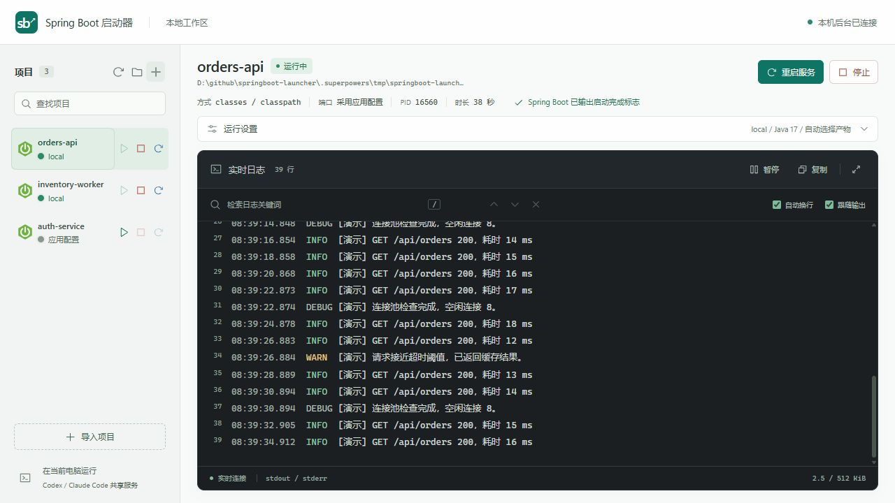
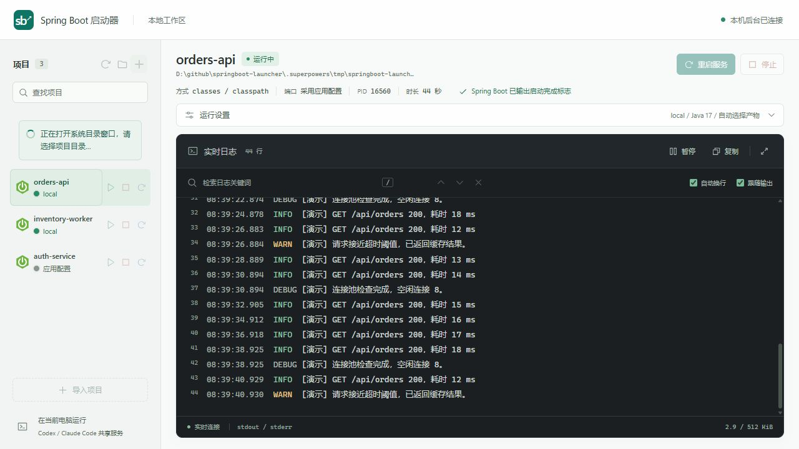
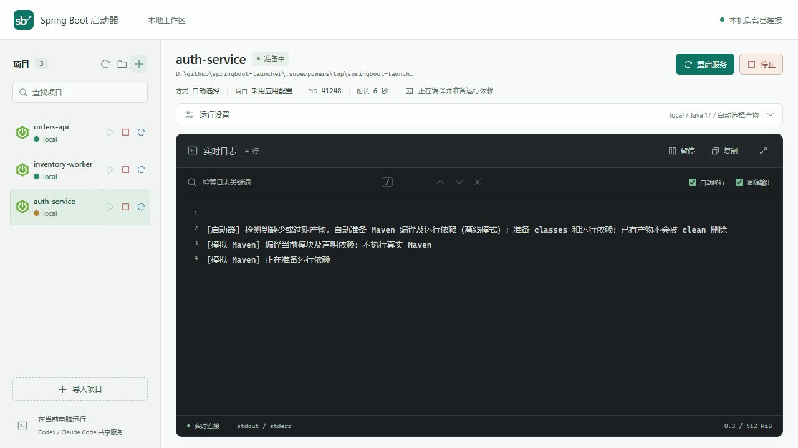
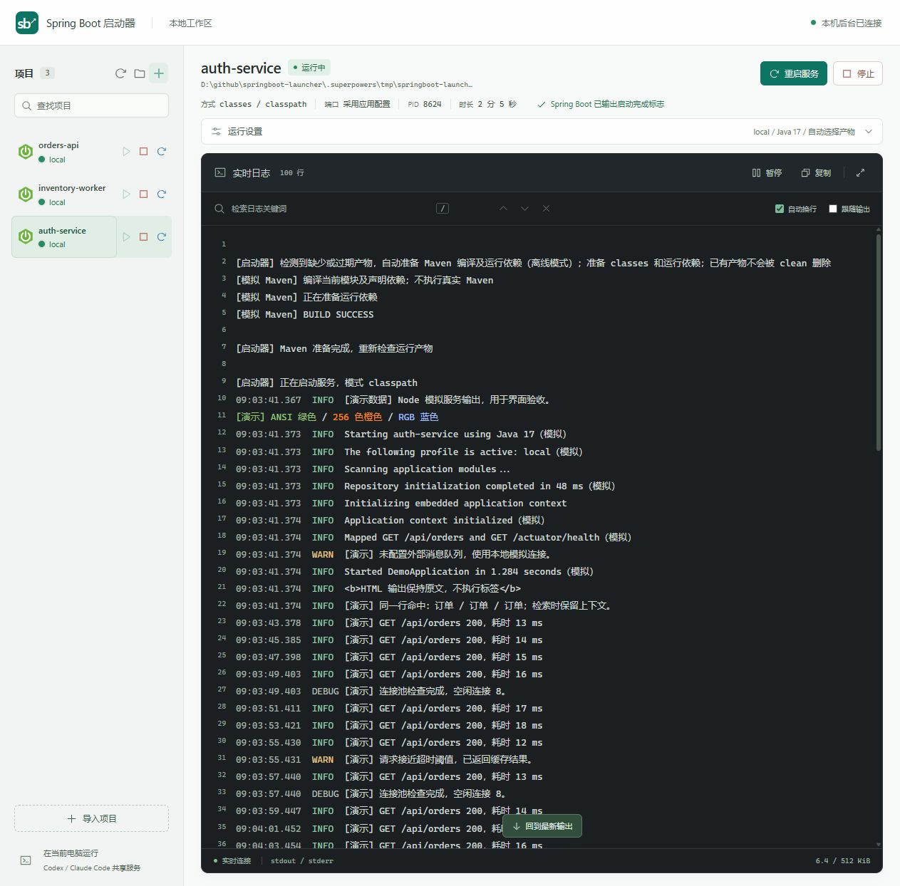

# dsh 运行能力对照与真实项目反馈

验证时间：2026-10-10。Windows 11、PowerShell 7、Node.js 22.22.2。对用户报告的三个本机模块只读取文件和生成启动计划，没有执行 Java、Maven、前端 build、业务代码或修改业务工程。

本页保留该轮历史证据。后续启动修复、网络重试、停止尾部日志、独立折叠和旧导入校正见[Alpha 验证补充](alpha-followups.md)，当前使用范围见[基础版本发布说明](../releases/0.1.0.md)。

## 根因与处理

| 用户反馈 | 根因 | 处理与证据 |
| --- | --- | --- |
| 点击加号及选中目录无反馈 | 原先只有一行等待文本，没有持续 loading 或扫描阶段 | 加入旋转指示、禁用重复点击、SSE 分阶段进度，真实浏览器观察到选择、扫描与完成 |
| 已有独立应用被提示缺少 classes | 薄 jar 的 manifest 含 config/，目录校验错误要求资源目录包含 class | 区分资源与字节码；用户应用含一个可执行薄 jar、130 个依赖及 config/，修复后只读启动计划通过并选择 jar |
| 基础包被列为服务 | 继承 Boot 依赖和 parent 即 matched；discover 也枚举全部非 pom 模块 | 发现和检查共用 Boot 注解加 main 入口筛选，用户基础模块只读检查 matched=false |
| 嵌套管理服务提示缺少依赖 | 用户模块实际没有 target；此前漏迁了 dsh 的自动 Maven 准备阶段 | 普通启动自动从根 reactor 编译并准备依赖，成功后重新检查再启动；已用隔离模拟进程验收，真实工程 Maven 成功仍待使用者验证 |

## 对照范围

研究 [DSH Spring Boot Launcher](https://github.com/simplifyOurLife/dsh-spring-boot-launcher) 的入口发现、inspect、buildDirectClasspath、findThinJar、模式选择和 dev-run-classpath 准备策略。

| 能力 | 当前结果 |
| --- | --- |
| Boot 服务入口筛选、完整限定注解、深包名 | 已实现，不用 starter／parent 或普通 classes 代替入口 |
| manifest 本地 jar 和资源目录 | 已实现，远端 URL 仍拒绝 |
| target/config、target/lib、target/dependency、assembly lib | 已实现，按优先级选择依赖目录，不把源码资源整体挂入运行类路径 |
| 嵌套 reactor 与传递内部依赖 | 已实现，只挂声明依赖，不挂共仓库其他应用 |
| 新 classes 覆盖旧内部 jar | 已实现，从生成的类路径排除匹配内部 jar，保留磁盘原文件 |
| 增量编译与过期资源 | 对应源码／复制资源分别核对；旧 jar 自动尝试新 classes |
| Windows 大依赖集合 | 相对路径压缩，未排除任何 jar 的整目录可用通配符；排除场景保留明确列表并执行参数长度上限 |
| 固定所选 Java 环境 | 固定 Maven 与 Java 子进程的 JAVA_HOME 与 PATH，不改全局环境 |
| Maven 编译和依赖准备 | 普通启动按需执行 compile／package 与 copy-dependencies；根 reactor 使用 -pl/-am，默认离线，可显式允许联网；不加独立构建按钮 |
| 准备期间日志与取消 | 立即返回 starting／preparing，同一日志区持续显示输出；Windows 停止托管进程树，失败不启动 Java，准备到启动之间也可取消 |
| dsh 宿主模式名称与 shell 执行方式 | 不逐字复制 dev-run／jar-run 等宿主模式；以 jar／classpath 加自动 Maven 准备实现本轮所需能力。自定义插件和完整 effective POM 仍需工程验收 |

实现使用独立 ESM 模块与参数数组，不移入宿主 API、Shell 启动字符串或删除依赖文件的行为。Maven XML 读取只支持本地常见结构，不等于 Maven effective POM；构建 Profile、复杂自定义插件与依赖冲突仍需工程验收。

## 验证

`npm test`：101 项全部通过（最终回归结果）。自动回归包含隔离配置、合成 class／jar、注入 Java 探测／执行器、本机 HTTP／SSE 和 Node 模拟服务，不执行真实 Java 或 Maven。新增用例覆盖资源目录、基础模块、限定注解、增量编译、包文档无需 class、深包名、360 个 assembly 依赖、旧 jar 回退、嵌套传递依赖与 dependencyManagement 区分、准备指引、过期资源和子进程 Java 环境。

自动准备另覆盖并发只创建一条流水线、Maven 失败退出码、准备期间停止、准备结束后的检查间隙取消、重启重新准备、noBuild、离线／联网参数、Wrapper 选择。Windows 使用实际 PowerShell／CMD 启动 Node 模拟后代，验证中文空格参数和整棵进程树终止；没有运行 mvn 或 javac。

浏览器使用延迟模拟目录选择器验证等待期间即时 loading、选择后的扫描提示、最终恢复按钮；缺产物模拟模块点击普通启动后显示“准备中”和模拟 Maven 日志，准备后自动启动 Node 模拟服务并识别就绪。控制台无警告／错误。真实 Windows 目录窗口速度未宣称改善，反馈覆盖整个等待期。

真实应用启动、Maven 准备成功与外部数据库等依赖连接仍由使用者验证。升级需在停止服务后退出旧后台，再重新打开；重新导入根目录可清理该范围旧版误识别记录。不应将只读启动计划通过写成 Java 服务启动成功。
