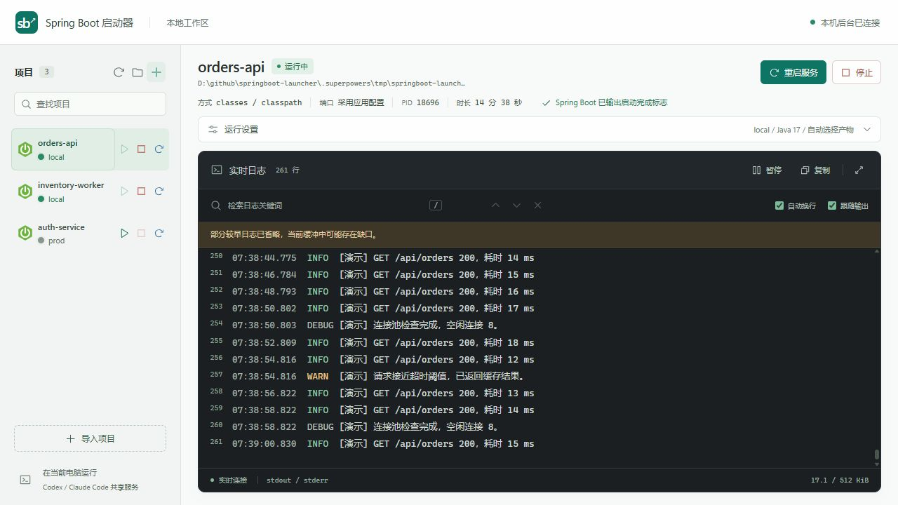
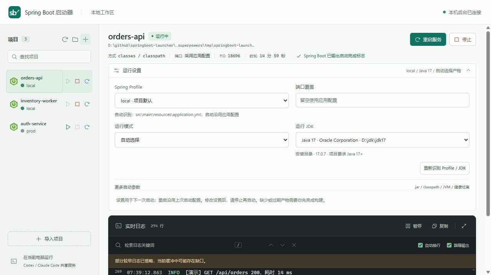
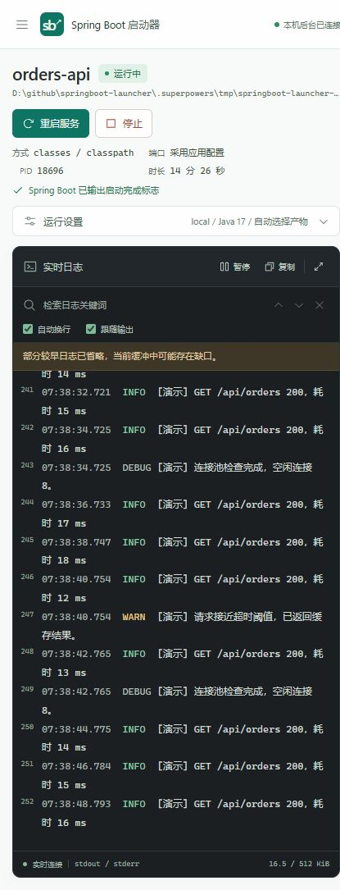

# Profile、JDK 与紧凑布局验证

验证时间：2026-10-10。环境为 Windows 11、PowerShell 7、Node.js 22.22.2。没有执行 Java、Maven 或前端 build，没有启动真实业务服务，也没有发布或推送。

## 实现范围

- 读取本地 application 配置的 Profile 默认值、来源、文件名、条件与分组候选；支持 properties、YAML、多文档、环境占位符回退，异常提示不带配置原文。
- JDK 候选来源、版本、兼容性与推荐接入共享 inspect API。扩展已知安装的同级目录发现，并读取项目 IDE／版本文件提示；扫描不执行 Java。
- 自动识别的 Profile 不额外覆盖应用配置，手动切换才覆盖；运行状态可根据 Spring 启动日志更新实际 Profile。
- 绿／红／蓝服务按钮、紧凑顶部摘要、默认收起运行设置和单独折叠高级参数。

## 自动验证

`npm test`：81 项通过，0 失败。覆盖配置格式与优先级、未解析占位符、敏感原文不外泄、自动 Profile 启动参数语义、多个 JDK 与 JRE 排除、inspect API 返回、启动日志 Profile 校正，以及既有认证、SSE、日志、进程和发行包回归。测试所用子进程为 Node 或注入探测，不执行 Java。

本机只读扫描发现 JDK 8、17、25 与 JRE 8。Java 17 项目推荐 JDK 17，JDK 8 和缺少 javac 的 JRE 在下拉框禁用。候选路径属于本机安装元数据，不上传外部服务。

## 真实浏览器与隔离模拟后台

通过 Codex 浏览器操作页面，后台运行隔离 Node 模拟服务：

1. 自动带入 local Profile 与 JDK 17，下拉框包含 dev、local、prod 及兼容 JDK 候选，显示配置来源。
2. 手动选择 dev／JDK 25 后重新识别，选择保持；切换到另一个项目再返回，草稿保持。
3. 选择“自动”后重新识别仍保留自动模式；自定义 JDK 入口按需显示路径输入。
4. 为另一个模拟服务选择 prod 后启动，侧栏显示 prod；停止仅操作该模拟服务。
5. 启动／停止／重启颜色分别为绿色、红色、蓝色，仍按后台状态禁用。
6. 1280×720 默认视口下，设置收起时日志容器从约 y=215 延伸至 y=702，高约 487px，页面无额外纵向滚动。检查 430px 与 320px 窄屏；320px 长路径标题溢出修复为容器内省略。

## 待使用者验收

真实 Maven 工程、Java 启停和实际 Codex／Claude Code 交叉使用仍待验收。Profile 扫描不完整模拟 Spring 配置环境，远程 import、自定义路径、复杂 IDE 参数和未解析构建占位符以运行日志为准；IDE JDK 名称只是推荐提示。旧后台需要在停止服务后退出重开才能载入新版逻辑。截图日志为模拟数据。
