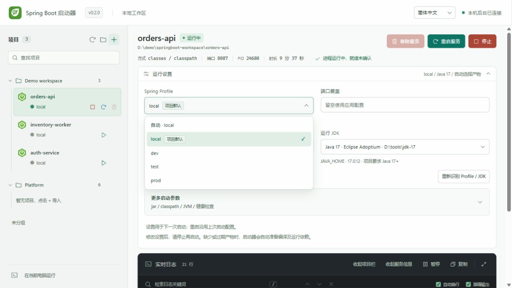
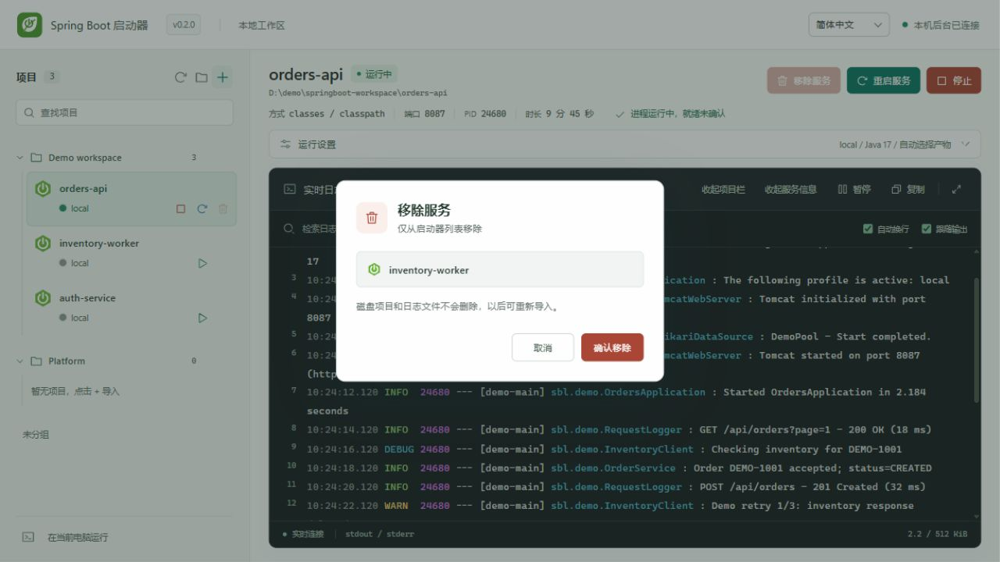

# 服务管理与日志提示交互优化

## 本轮改动

- `project.move` 接受可选的 `beforeProjectKey`，`null` 表示移至该组末尾。数组顺序与分组一起保存，拒绝跨组或不存在的锚点；MCP 直接启动的未导入服务可以在首次移动时一起登记。
- 面板按工作区保存的顺序渲染，拖动显示插入线；支持文件夹、未分组与 Ctrl+Shift+↑/↓ 排序。
- 从左侧启动／重启服务时，先选中并订阅该服务日志。
- 移除服务使用站内 `dialog`，取消按钮默认获得焦点，支持 Esc、提交等待和状态重检；只移除记录。
- 默认 Profile 文本保留原始名称，“项目默认”是独立标签；更多启动参数使用两行摘要与独立边框，设置说明分行显示。
- 同步状态按钮只读取本机后台的工作区及服务状态，不重启服务、不扫描项目。
- 日志范围说明、高亮限制、写盘告警和检索提示增加关闭按钮。该页面当前服务轮次中的后续输出与重连保留关闭状态；切换服务／新轮次重置，重新进入检索恢复检索说明。页面刷新不持久化这些关闭状态。

## 验证证据

- 工作区与移除 10 项定向测试通过，含排序恢复、无效锚点、运行状态保护、移除接口鉴权；日志状态 7 项定向测试通过。补充 MCP 记录原子登记后重新执行排序与提示关闭两个相关用例，均通过。
- 隔离浏览器面板使用事件对象模拟进程，无真实 Java／Maven。验证点击 B 服务启动后选择与日志切到 B、鼠标从末项拖至首位、键盘上移、刷新后顺序、确认与取消移除、中英文默认标签与启动参数布局。
- 用 1300 多行模拟日志触发行数范围说明，关闭后继续检索仍隐藏；检索状态提示也可独立关闭。控制台无错误。
- JavaScript 语法与 Git 空白检查通过；没有前后端构建或本地全量回归。

上述交互验收来自隔离预览。完成后经使用者明确确认，正常停止正在运行的服务并重启正式启动器后台；新版面板已连接，项目分组仍可读取，没有替使用者重新启动业务 Java 服务。

## 0.2.0 界面示例

以下图片使用当前产品页面与公开模拟数据，展示默认 Profile 标签、自定义下拉选项和站内移除确认。它们补充界面说明，不替代上述交互测试。

